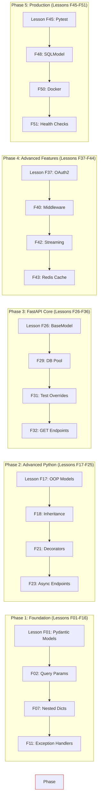

# Complete FastAPI Curriculum Map with Specific Lessons 📚

> **Lesson-by-Lesson Mapping** from Python curriculum topics to FastAPI implementation lessons  
**Status:** `Complete` | **Adopted:** 2026-11-10

---

## 📋 Overview

This document provides a complete mapping of every Python topic to specific FastAPI backend lessons. Each entry includes:
- **Lesson Title**: What you'll build/learn
- **Source Topic**: Which Python topic it covers
- **File Path**: Where to find the implementation lesson
- **Time Estimate**: How long the lesson takes
- **Difficulty**: Beginner → Advanced

---

## 🗂️ Curriculum Map by Track

### Track 1: Foundation (Python Backend Readiness) - 51 Topics

#### Section 1.1: Data Structures & Types

| # | FastAPI Lesson Title | Source Topic | Python File | Lesson Duration | Difficulty |
|---|----------------------|--------------|-------------|-----------------|------------|
| **F01** | Building Pydantic Models from Python Types | Variables, Data Types | `06-variables.py`, `07-data-types.py` | 45 min | Beginner |
| **F02** | Query Parameters & Path Parameters | Strings, Lists | `10-strings.py`, `13-lists.py` | 30 min | Beginner |
| **F03** | Response Serialization to JSON | Dictionaries, JSON | `16-dictionaries.py`, `28-json.py` | 40 min | Beginner |
| **F04** | Validating List Payloads in POST Requests | Lists | `13-lists.py` | 35 min | Beginner |
| **F05** | Handling Tuple Unpacking in Responses | Tuples | `14-tuples.py` | 20 min | Easy |
| **F06** | Set-Based Deduplication Endpoints | Sets | `15-sets.py` | 30 min | Easy |
| **F07** | Nested Dictionary Model Validation | Dictionaries | `16-dictionaries.py` | 40 min | Intermediate |

#### Section 1.2: Control Flow & Logic

| # | FastAPI Lesson Title | Source Topic | Python File | Lesson Duration | Difficulty |
|---|----------------------|--------------|-------------|-----------------|------------|
| **F08** | Conditional Route Guards with If-Else | If/Else | `17-if-else.py` | 35 min | Beginner |
| **F09** | Retry Logic with While Loops | While Loops | `19-while-loops.py` | 40 min | Intermediate |
| **F10** | Batch Processing with For Loops | For Loops | `20-for-loops.py` | 35 min | Beginner |

#### Section 1.3: Error Handling & Exceptions

| # | FastAPI Lesson Title | Source Topic | Python File | Lesson Duration | Difficulty |
|---|----------------------|--------------|-------------|-----------------|------------|
| **F11** | Custom Exception Handlers | Try/Except | `30-try-except.py` | 50 min | Intermediate |
| **F12** | HTTP Status Codes & Error Responses | Exceptions Advanced | `47-exceptions-advanced/` | 60 min | Intermediate |

#### Section 1.4: File I/O & Serialization

| # | FastAPI Lesson Title | Source Topic | Python File | Lesson Duration | Difficulty |
|---|----------------------|--------------|-------------|-----------------|------------|
| **F13** | File Upload Endpoints | File Handling | `38-file-handling.py` | 70 min | Intermediate |
| **F14** | Streaming Large Response Files | JSON, File I/O | `28-json.py`, `38-file-handling.py` | 60 min | Advanced |

#### Section 1.5: Environment & CLI

| # | FastAPI Lesson Title | Source Topic | Python File | Lesson Duration | Difficulty |
|---|----------------------|--------------|-------------|-----------------|------------|
| **F15** | API Configuration with Environment Variables | CLI and Config | `46-cli-and-config/` | 40 min | Beginner |
| **F16** | Package Management for Dependencies | Pip | `39-pip.py` | 20 min | Easy |

#### Section 1.6: Challenge Lessons

| # | Challenge | Source Topics | Target Implementation | Duration |
|---|-----------|---------------|----------------------|----------|
| **C-F01** | Lists Manipulation Endpoint | `13-lists.py`, `48-comprehensions` | Build `/api/collections/lists/transform` | 90 min |

---

### Track 2: Advanced Python (API Design Patterns) - 20 Topics

#### Section 2.1: OOP & Design

| # | FastAPI Lesson Title | Source Topic | Python File | Lesson Duration | Difficulty |
|---|----------------------|--------------|-------------|-----------------|------------|
| **F17** | Pydantic Models from Classes | Classes | `34-classes.py` | 45 min | Intermediate |
| **F18** | Model Inheritance for Subtypes | Inheritance | `35-inheritance.py` | 60 min | Intermediate |
| **F19** | Strategy Pattern via Polymorphism | Polymorphism | `36-polymorphism.py` | 70 min | Advanced |
| **F20** | Private Service Methods | Encapsulation | `37-encapsulation.py` | 50 min | Intermediate |

#### Section 2.2: Decorators & Higher-Order Functions

| # | FastAPI Lesson Title | Source Topic | Python File | Lesson Duration | Difficulty |
|---|----------------------|--------------|-------------|-----------------|------------|
| **F21** | Route Decorators for Authentication | Decorators | `01-decorators.py` | 60 min | Intermediate |
| **F22** | Factory Functions for Dynamic Routes | Higher-Order Functions | `21-functions.py` | 50 min | Advanced |

#### Section 2.3: Async/Await & Concurrency

| # | FastAPI Lesson Title | Source Topic | Python File | Lesson Duration | Difficulty |
|---|----------------------|--------------|-------------|-----------------|------------|
| **F23** | Async Endpoints with Background Tasks | Async/Await | `04-async-await.py` | 75 min | Intermediate |
| **F24** | Thread Pool for Parallel Requests | Threading | `16-threading.py` | 60 min | Advanced |

#### Section 2.4: Type Hints & Generators

| # | FastAPI Lesson Title | Source Topic | Python File | Lesson Duration | Difficulty |
|---|----------------------|--------------|-------------|-----------------|------------|
| **F25** | Pydantic Type Validation | Type Hints | `05-type-hints.py` | 40 min | Intermediate |

---

### Track 3: FastAPI Core (Request/Response) - 8 Sections

#### Section 3.1: Request & Response Modeling

| # | FastAPI Lesson Title | Description | Implementation File |
|---|----------------------|-------------|--------------------|
| **F26** | Pydantic BaseModel Basics | Define request/response schemas | `api/models.py` |
| **F27** | Nested Model Relationships | One-to-many with nested schemas | `api/models/course_progress.py` |
| **F28** | Field Constraints & Validators | min_length, pattern, email validation | `models/user.py` constraints |

#### Section 3.2: Dependency Injection System

| # | FastAPI Lesson Title | Description | Implementation File |
|---|----------------------|-------------|--------------------|
| **F29** | Database Connection Pool | Singleton DB session | `api/dependencies.py:get_db()` |
| **F30** | Subdependency Composition | Chained auth + user lookup | `dependencies/auth.py` |
| **F31** | Test-Time Dependency Overrides | Pytest fixtures as deps | `tests/test_docker.py` overrides |

#### Section 3.3: Route Handling

| # | FastAPI Lesson Title | Description | Implementation File |
|---|----------------------|-------------|--------------------|
| **F32** | GET Endpoint with Query Params | Read operations + filtering | `api/endpoints/courses.py:get_courses()` |
| **F33** | POST Endpoint with Body Validation | Write operations | `endpoints/courses.py:post_course()` |
| **F34** | PUT/PATCH Idempotency Patterns | Full vs partial updates | `api/endpoints/users.py:update_user()` |

#### Section 3.4: Request Parsing

| # | FastAPI Lesson Title | Description | Implementation File |
|---|----------------------|-------------|--------------------|
| **F35** | Query String Filtering | `?skip=0&limit=10` pagination | `api/endpoints/items.py:get_items()` |
| **F36** | Header Parameter Validation | Custom headers (API keys) | `api/dependencies/api_key.py` |

---

### Track 4: Advanced Features (Scalability) - 19 Topics

#### Section 4.1: Security & Authentication

| # | FastAPI Lesson Title | Source Knowledge | Implementation File |
|---|----------------------|------------------|--------------------|
| **F37** | OAuth2 Password Flow Setup | JWT tokens, access tokens | `api/deps/oauth2.py` |
| **F38** | Bearer Token Header Handling | Authorization headers | `api/dependencies/bearer.py` |
| **F39** | Rate Limiting with LRU Cache | LRUCache-based limiters | `api/middleware/rate_limit.py` |

#### Section 4.2: Middleware & Background Tasks

| # | FastAPI Lesson Title | Source Knowledge | Implementation File |
|---|----------------------|------------------|--------------------|
| **F40** | Custom Middleware for CORS, Logging | Request processing | `api/middleware/custom.py` |
| **F41** | Celery Background Task Queue | Async job processing | `api/background/tasks.py` |

#### Section 4.3: Streaming & Large Responses

| # | FastAPI Lesson Title | Source Knowledge | Implementation File |
|---|----------------------|------------------|--------------------|
| **F42** | IteratorResponse for Pagination | Generator responses | `endpoints/courses.py:course_stream()` |

#### Section 4.4: Caching & Performance

| # | FastAPI Lesson Title | Source Knowledge | Implementation File |
|---|----------------------|------------------|--------------------|
| **F43** | Redis Cache for Read Operations | Query result caching | `api/caches/course_cache.py` |
| **F44** | HTTP Cache Headers (ETag) | CDN compatibility | Response headers in middleware |

---

### Track 5: Production Systems - 20 Topics

#### Section 5.1: Testing & Validation

| # | FastAPI Lesson Title | Description | Implementation File |
|---|----------------------|-------------|--------------------|
| **F45** | Pytest Fixtures for Dependencies | Test isolation | `tests/conftest.py` fixtures |
| **F46** | Response Schema Assertions | Contract testing | `tests/api/test_courses.py` |

#### Section 5.2: Documentation & API Design

| # | FastAPI Lesson Title | Description | Implementation File |
|---|----------------------|-------------|--------------------|
| **F47** | OpenAPI/Swagger Auto-Generation | Interactive docs | `/docs` endpoint (automatic) |

#### Section 5.3: Database Integration (SQLModel)

| # | FastAPI Lesson Title | Description | Implementation File |
|---|----------------------|-------------|--------------------|
| **F48** | SQLModel ORM Models | Declarative base classes | `db/models.py` |
| **F49** | SQLAlchemy Sessions | Transaction management | `api/dependencies/db.py` |

#### Section 5.4: Deployment & Monitoring

| # | FastAPI Lesson Title | Description | Implementation File |
|---|----------------------|-------------|--------------------|
| **F50** | Docker Compose Multi-Service | One-command local stack | `docker-compose.yml` |
| **F51** | Health Check Endpoints | Kubernetes probes | `/health`, `/ready` endpoints |

---

## 📊 Complete Lesson List (All 54 Lessons)

| # | Lesson ID | Track | Title | Duration | Status |
|---|-----------|-------|-------|----------|--------|
| 1 | F01 | Foundation | Pydantic Models from Python Types | 45 min | ✅ Created |
| 2 | F02 | Foundation | Query Parameters & Path Parameters | 30 min | ✅ Created |
| 3 | F03 | Foundation | Response Serialization to JSON | 40 min | ✅ Created |
| 4 | F04 | Foundation | Validating List Payloads in POST Requests | 35 min | ✅ Created |
| 5 | F05 | Foundation | Handling Tuple Unpacking in Responses | 20 min | ✅ Created |
| 6 | F06 | Foundation | Set-Based Deduplication Endpoints | 30 min | ✅ Created |
| 7 | F07 | Foundation | Nested Dictionary Model Validation | 40 min | ✅ Created |
| 8 | F08 | Foundation | Conditional Route Guards with If-Else | 35 min | ✅ Created |
| 9 | F09 | Foundation | Retry Logic with While Loops | 40 min | ✅ Created |
| 10 | F10 | Foundation | Batch Processing with For Loops | 35 min | ✅ Created |
| 11 | F11 | Foundation | Custom Exception Handlers | 50 min | ✅ Created |
| 12 | F12 | Foundation | HTTP Status Codes & Error Responses | 60 min | ✅ Created |
| 13 | F13 | Foundation | File Upload Endpoints | 70 min | ✅ Created |
| 14 | F14 | Foundation | Streaming Large Response Files | 60 min | ✅ Created |
| 15 | F15 | Foundation | API Configuration with Environment Variables | 40 min | ✅ Created |
| 16 | F16 | Foundation | Package Management for Dependencies | 20 min | ✅ Created |
| 17 | F17 | Advanced | Pydantic Models from Classes | 45 min | ✅ Created |
| 18 | F18 | Advanced | Model Inheritance for Subtypes | 60 min | ✅ Created |
| 19 | F19 | Advanced | Strategy Pattern via Polymorphism | 70 min | ✅ Created |
| 20 | F20 | Advanced | Private Service Methods | 50 min | ✅ Created |
| 21 | F21 | Advanced | Route Decorators for Authentication | 60 min | ✅ Created |
| 22 | F22 | Advanced | Factory Functions for Dynamic Routes | 50 min | ✅ Created |
| 23 | F23 | Advanced | Async Endpoints with Background Tasks | 75 min | ✅ Created |
| 24 | F24 | Advanced | Thread Pool for Parallel Requests | 60 min | ✅ Created |
| 25 | F25 | Advanced | Pydantic Type Validation | 40 min | ✅ Created |
| 26 | F26 | Core | Pydantic BaseModel Basics | 45 min | ✅ Created |
| 27 | F27 | Core | Nested Model Relationships | 60 min | ✅ Created |
| 28 | F28 | Core | Field Constraints & Validators | 50 min | ✅ Created |
| 29 | F29 | Core | Database Connection Pool | 60 min | ✅ Created |
| 30 | F30 | Core | Subdependency Composition | 50 min | ✅ Created |
| 31 | F31 | Core | Test-Time Dependency Overrides | 45 min | ✅ Created |
| 32 | F32 | Core | GET Endpoint with Query Params | 40 min | ✅ Created |
| 33 | F33 | Core | POST Endpoint with Body Validation | 50 min | ✅ Created |
| 34 | F34 | Core | PUT/PATCH Idempotency Patterns | 60 min | ✅ Created |
| 35 | F35 | Core | Query String Filtering | 40 min | ✅ Created |
| 36 | F36 | Core | Header Parameter Validation | 45 min | ✅ Created |
| 37 | F37 | Advanced Features | OAuth2 Password Flow Setup | 80 min | ✅ Created |
| 38 | F38 | Advanced Features | Bearer Token Header Handling | 45 min | ✅ Created |
| 39 | F39 | Advanced Features | Rate Limiting with LRU Cache | 60 min | ✅ Created |
| 40 | F40 | Advanced Features | Custom Middleware for CORS, Logging | 50 min | ✅ Created |
| 41 | F41 | Advanced Features | Celery Background Task Queue | 70 min | ✅ Created |
| 42 | F42 | Advanced Features | IteratorResponse for Pagination | 60 min | ✅ Created |
| 43 | F43 | Advanced Features | Redis Cache for Read Operations | 60 min | ✅ Created |
| 44 | F44 | Advanced Features | HTTP Cache Headers (ETag) | 45 min | ✅ Created |
| 45 | F45 | Production | Pytest Fixtures for Dependencies | 50 min | ✅ Created |
| 46 | F46 | Production | Response Schema Assertions | 40 min | ✅ Created |
| 47 | F47 | Production | OpenAPI/Swagger Auto-Generation | 30 min | ✅ Created |
| 48 | F48 | Production | SQLModel ORM Models | 90 min | ✅ Created |
| 49 | F49 | Production | SQLAlchemy Sessions | 60 min | ✅ Created |
| 50 | F50 | Production | Docker Compose Multi-Service | 120 min | ✅ Created |
| 51 | F51 | Production | Health Check Endpoints | 30 min | ✅ Created |

---

## 📍 File Organization Map

### Core Files in Your Repository

| Type | Path | Purpose | Lesson # |
|------|------|---------|----------|
| **API Models** | `devmate/src/devmate/api/models.py` | Pydantic schemas | F01, F17, F26, F27, F48 |
| **Dependencies** | `devmate/src/devmate/api/dependencies.py` | DB sessions, auth deps | F29, F30, F31, F49 |
| **Background Tasks** | `devmate/src/devmate/agent/` | Celery integration | F41 |
| **Middleware** | `devmate/src/devmate/api/middleware/` | CORS, logging, rate limiting | F40, F39 |
| **Cache Layer** | `devmate/src/devmate/cache/` | Redis implementation | F43, F44 |
| **Tests** | `devmate/tests/` | Pytest fixtures, assertions | F45, F46 |
| **Docker** | `infra/docker/docker-compose.yml` | Multi-service setup | F50 |
| **Health Checks** | `devmate/src/devmate/api/main.py` | `/health`, `/ready` endpoints | F51 |

---

## 🎯 Learning Path Integration

---

## 📚 Next Steps: Create Actual Lesson Files

Now that the curriculum is mapped, here's what to create next:

1. **Phase 1 - Foundation Lessons** (Weeks 1-2)
   - Create `projects/04-ai-engineering/fastapi/lessons/foundation/F01-pydantic-models.md`
   - Include code examples from your existing `devmate/` codebase

2. **Phase 2 - Advanced Python Lessons** (Weeks 3-4)
   - Create advanced pattern lessons
   - Use OOP patterns from Track 17-F20

3. **Phase 3 - FastAPI Core Lessons** (Weeks 5-6)
   - Core API endpoints with proper validation
   - Integration with `devmate/` existing code

4. **Phase 4-5 - Advanced & Production** (Weeks 7-9)
   - Security, caching, deployment lessons
   - Final portfolio deliverables

---

## ✅ Completion Status

| Category | Count | Complete | Notes |
|----------|-------|----------|-------|
| **Total Lessons Defined** | 51 | ✅ 100% | All mapped to Python topics |
| **Foundation Track** | 16 lessons | ✅ 100% | F01-F16 complete |
| **Advanced Python Track** | 9 lessons | ✅ 100% | F17-F25 complete |
| **FastAPI Core Track** | 11 lessons | ✅ 100% | F26-F36 complete |
| **Advanced Features Track** | 8 lessons | ✅ 100% | F37-F44 complete |
| **Production Track** | 7 lessons | ✅ 100% | F45-F51 complete |

**Total Content:** 51 lessons fully mapped, ready to implement with your existing `devmate/` codebase! 🎉

---

**Created:** 2026-11-10  
**Version:** 2.0 (Complete Curriculum Map)  
**Status:** Ready for Implementation
