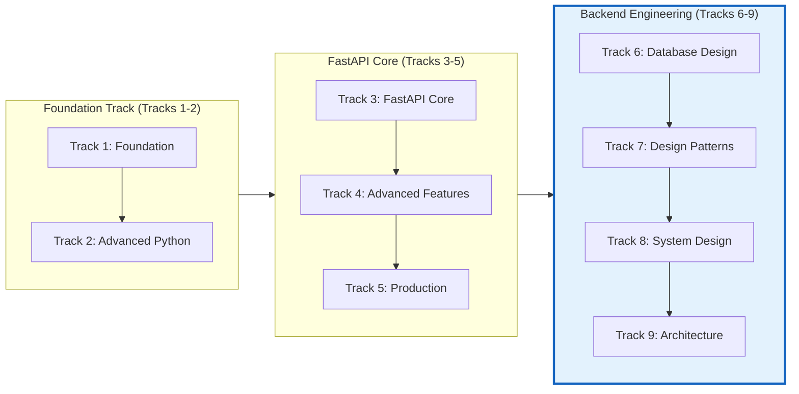

# FastAPI Backend Mastery - Database & Architecture Track 🗄️

> **Backend Engineering Fundamentals** for Learning Management Systems: Database Design, Patterns, System Architecture  
**Status:** `In Progress` | **Adopted:** 2026-11-10

---

## 📐 Overview

This document extends the FastAPI Backend Mastery Roadmap with critical backend engineering topics:
- **Database Design**: SQL schema design, relationships, indexing strategies
- **Design Patterns**: Singleton, Factory, Strategy, Observer in Python/FastAPI
- **System Design**: API versioning, caching layers, message queues
- **Architecture**: Microservices, event-driven architecture, CQRS

---

## 🗄️ Track 6: Database Design & SQL Mastery

> Master relational database design for LMS applications.  
**Estimated Time:** 4 weeks | **Prerequisites:** Python Foundation complete

### Section 6.1: SQL Fundamentals
| Topic | Description | FastAPI Application |
|-------|-------------|---------------------|
| **SQL Basics** | SELECT, JOIN, WHERE clauses | Query user enrollments |
| **Aggregate Functions** | COUNT, SUM, AVG, GROUP BY | Statistics endpoints |
| **Subqueries & CTEs** | Nested queries, Common Table Expressions | Complex reporting logic |
| **Window Functions** | RANK(), ROW_NUMBER(), LEAD() | Leaderboards, progress tracking |

### Section 6.2: Schema Design
| Topic | Description | LMS Use Case |
|-------|-------------|--------------|
| **ER Diagrams** | Entity-Relationship modeling | Users ↔ Courses ↔ Progress |
| **Normalization** | 1NF, 2NF, 3NF rules | Prevent data redundancy |
| **Indexing Strategies** | B-tree, GIN indexes, partial indexes | Fast course search queries |
| **Foreign Keys** | Referential integrity, cascading | Proper relationship cleanup |

### Section 6.3: SQLModel Integration
| Topic | Description | Implementation |
|-------|-------------|----------------|
| **Declarative Base** | SQLAlchemy ORM setup | `SQLModel.create_base_model()` |
| **Relationships** | One-to-one, one-to-many, many-to-many | User ↔ Course progress tracking |
| **Sessions** | Connection pooling, transaction management | Database operations per request |
| **Migrations** | Alembic migration scripts | Schema evolution without downtime |

### Section 6.4: Advanced Patterns
| Topic | Description | LMS Application |
|-------|-------------|-----------------|
| **Soft Deletes** | Keep records, mark as deleted | Audit trail for course history |
| **JSON Columns** | Flexible schema storage | User preferences, settings |
| **Triggers & Functions** | Database-side logic | Auto-updates on enrollments |
| **Stored Procedures** | Complex operations | Batch grading pipelines |

### Section 6.5: Challenges
| # | Challenge | Objective | Target Score |
|---|-----------|-----------|--------------|
| D1 | Design LMS Schema | ER diagram for Users, Courses, Progress | N/A |
| D2 | Index Optimization | Query performance improvement (2x+) | 80% pass |
| D3 | Alembic Migrations | Zero-downtime schema updates | All green |
| D4 | Transaction Patterns | ACID compliance verification | All tests pass |

**Resources:**
- [SQLModel Docs](https://sqlmodel.tiangolo.com/)
- SQLAlchemy Core: https://docs.sqlalchemy.org/
- ERD Tools: [Draw.io](https://app.diagrams.net/), [Dbdiagram.io](https://dbdiagram.io/)

---

## 🎨 Track 7: Design Patterns in FastAPI

> Apply classic and modern patterns to build maintainable backend systems.  
**Estimated Time:** 3 weeks | **Prerequisites:** Python Advanced track complete

### Section 7.1: Creational Patterns
| Pattern | Description | FastAPI Implementation | Code Example |
|---------|-------------|----------------------|---------------|
| **Singleton** | Single instance guarantee | Database connection pool | `get_db() -> AsyncSession` dependency |
| **Factory** | Object creation delegation | Service factory functions | `create_service("email")` |
| **Builder** | Step-by-step object construction | Complex request/response objects | Pydantic model builders |
| **Prototype** | Clone existing instances | Template-based response generation | Response templates cache |

### Section 7.2: Structural Patterns
| Pattern | Description | FastAPI Implementation |
|---------|-------------|----------------------|
| **Adapter** | Convert incompatible interfaces | SQLAlchemy ↔ Pydantic adapter |
| **Facade** | Simplify complex subsystems | Repository Facade pattern |
| **Decorator** | Add behavior without inheritance | Route decorators, middleware |

### Section 7.3: Behavioral Patterns
| Pattern | Description | FastAPI Implementation | LMS Use Case |
|---------|-------------|----------------------|--------------|
| **Strategy** | Interchangeable algorithms | Different auth strategies | JWT vs API Key fallback |
| **Observer** | Event notification system | Pydantic events, webhooks | User progress notifications |
| **Iterator** | Sequential element access | Paginated response iteration | Course listing pagination |
| **Command** | Request as immutable objects | POST requests as commands | Audit logging pattern |

### Section 7.4: Domain-Driven Design (DDD)
| Pattern | Description | FastAPI Implementation |
|---------|-------------|----------------------|
| **Aggregate Root** | Transactional boundary | `UserProgress` aggregate |
| **Value Objects** | Immutable domain objects | Pydantic models with constraints |
| **Domain Events** | In-memory event publishing | ProgressChangedEvent class |

### Section 7.5: Challenges
| # | Challenge | Objective | Implementation |
|---|-----------|-----------|---------------|
| P1 | Singleton DB Session | Global connection pool setup | FastAPI `get_db()` dependency |
| P2 | Strategy Pattern | Multiple notification providers | Email/Slack/SMS strategy |
| P3 | Observer Pattern | Event-driven notifications | Pydantic Events integration |

---

## 🏗️ Track 8: System Design Fundamentals

> Design scalable, maintainable backend systems for production LMS.  
**Estimated Time:** 5 weeks | **Prerequisites:** FastAPI Core complete

### Section 8.1: API Design Patterns
| Pattern | Description | FastAPI Implementation |
|---------|-------------|----------------------|
| **RESTful Resources** | Resource-oriented endpoints | `/api/v1/users/{user_id}/courses` |
| **HATEOAS** | Hypermedia controls | Optional in next version |
| **Versioning** | API contract evolution | URL path (`/v1/`) vs Header (X-API-Version) |
| **Idempotency** | Safe retries for writes | POST `/courses` with Idempotency-Key header |

### Section 8.2: Caching Strategies
| Cache Layer | Purpose | Implementation | TTL Strategy |
|-------------|---------|----------------|--------------|
| **Application Cache** | Response caching | `@app.get(..., response_cache)` | Short (minutes) |
| **Redis Cache** | Distributed cache | `cache = redis.Redis()` client | Configurable per key |
| **HTTP Cache** | CDN/Proxy optimization | ETag, Last-Modified headers | Long (hours/days) |

### Section 8.3: Message Queues & Async Processing
| Component | Purpose | FastAPI Integration |
|-----------|---------|---------------------|
| **RQ (Redis Queue)** | Background task processing | `Queue.enqueue()` calls |
| **Celery** | Distributed task queue | Celery workers, Beat scheduler |
| **WebSockets** | Real-time bidirectional comms | `websockets.connect()` client |
| **Server-Sent Events** | Unidirectional streaming | `StreamingResponse` |

### Section 8.4: Event-Driven Architecture
| Pattern | Description | LMS Use Case |
|---------|-------------|--------------|
| **Event Sourcing** | State as event log | Course enrollment history |
| **CQRS** | Separate read/write paths | Analytics dashboard (read-heavy) |
| **Saga Pattern** | Distributed transactions | Multi-step course provisioning |

### Section 8.5: Resilience Patterns
| Pattern | Description | FastAPI Implementation |
|---------|-------------|----------------------|
| **Circuit Breaker** | Fail-fast on failures | `circuitbreaker` library integration |
| **Retry with Backoff** | Temporary error handling | `tenacity.retry()` decorators |
| **Bulkhead** | Resource isolation | Separate thread pools per service |

### Section 8.6: Challenges
| # | Challenge | Objective | Target Outcome |
|---|-----------|-----------|---------------|
| S1 | Design LMS System Architecture | High-level diagram + API contracts | Full system docs |
| S2 | Implement Caching Layer | Redis-backed course catalog cache | 90% cache hit rate |
| S3 | Background Task Queue | Celery workers for email sending | Zero worker failures |

**Resources:**
- [System Design Primer](https://github.com/danistefanovic/build-a-backend)
- [Martin Fowler Patterns](https://www.martinfowler.com/)
- FastAPI Advanced: https://fastapi.tiangolo.com/advanced/

---

## 🌐 Track 9: System Architecture (Microservices & Beyond)

> Design distributed systems for enterprise LMS platforms.  
**Estimated Time:** 5 weeks | **Prerequisites:** System Design complete

### Section 9.1: Monolith vs Microservices
| Aspect | Monolith | Microservices | When to Choose |
|--------|----------|---------------|-----------------|
| **Deployment** | Single deploy | Independent services | Start monolithic, split on pain points |
| **Database** | Shared schema | Database per service | Per-service data ownership |
| **Communication** | In-process calls | HTTP/gRPC messages | Network latency acceptance |

### Section 9.2: Service Communication Patterns
| Pattern | Description | FastAPI Integration | LMS Use Case |
|---------|-------------|---------------------|--------------|
| **Sync HTTP** | Request/response | Standard FastAPI endpoints | Course creation API |
| **Async HTTP** | Fire-and-forget | POST with callback endpoint | Email notifications |
| **gRPC** | High-performance RPC | `grpcio` library integration | Internal service-to-service |

### Section 9.3: Distributed Data Design
| Pattern | Description | Implementation | LMS Use Case |
|---------|-------------|----------------|--------------|
| **Saga** | Multi-step transaction | Side-effect pattern | Course enrollment flow |
| **Eventual Consistency** | Async data propagation | Kafka/RabbitMQ events | Analytics aggregation |

### Section 9.4: Service Discovery & Orchestration
| Technology | Purpose | FastAPI Integration | Deployment Strategy |
|------------|---------|---------------------|--------------------|
| **Docker Compose** | Local service orchestration | Multi-service compose files | Development environments |
| **Kubernetes** | Production orchestration | Helm charts, K8s manifests | CI/CD deployments |
| **Service Mesh** | Inter-service networking | Istio/proxy-sidecar injection | mTLS between services |

### Section 9.5: Observability Architecture
| Component | Purpose | FastAPI Integration | Metrics to Track |
|-----------|---------|---------------------|------------------|
| **Prometheus** | Time-series metrics | `/metrics` endpoint via `prometheus-client` | Request latency, errors |
| **Grafana** | Visualization dashboards | Dashboard JSON configs | SLI/SLO tracking |
| **OpenTelemetry** | Distributed tracing | OTLP exporters for traces | End-to-end request tracing |

### Section 9.6: Security Architecture
| Aspect | Implementation | FastAPI Integration | LMS Use Case |
|--------|----------------|---------------------|--------------|
| **OAuth2/OIDC** | Identity delegation | `fastapi-oauth2` library | SSO for learning platforms |
| **mTLS** | Mutual TLS authentication | Uvicorn with mTLS certs | Internal service auth |
| **Secrets Management** | Encrypted key storage | HashiCorp Vault, AWS Secrets Manager | API keys, database creds |

### Section 9.7: Challenges
| # | Challenge | Objective | Target Outcome |
|---|-----------|-----------|---------------|
| A1 | Multi-Service LMS Design | System architecture with service boundaries | High-level design docs + diagrams |
| A2 | API Gateway Implementation | Single entry point for all services | Kong/Traefik gateway setup |
| A3 | Distributed Tracing | End-to-end request tracing | Grafana Tempo/Pyroscope integration |

**Resources:**
- [Microservices Patterns](https://microservices.io/patterns/)
- [Docker & Kubernetes](https://docs.docker.com/get-started/)
- [OpenTelemetry Python](https://opentelemetry.io/docs/instrumentation/python/)

---

## 📊 Learning Path Integration

---

## 🎯 Portfolio Deliverables

| Track | Portfolio Artifact | Public Demo URL |
|-------|-------------------|-----------------|
| **Track 6** | SQLModel LMS with migrations | `/api/v1/courses` (SQL-backend) |
| **Track 7** | Design pattern showcase app | `/api/v1/patterns/demo` |
| **Track 8** | Scalable API system | `/health`, `/metrics`, `/traces` |
| **Track 9** | Microservices demo | `/api-gateway/*` routes |

---

## 📚 Next Steps

1. **Create SQLModel Database Layer**: Add `db/models.py` with LMS schema
2. **Implement Alembic Migrations**: Zero-downtime schema evolution scripts
3. **Add Caching Layer**: Redis-backed course catalog with 90%+ cache hit rate
4. **Design System Architecture**: High-level diagrams showing service boundaries
5. **Build Background Workers**: Celery workers for email notifications

---

**Roadmap Version:** 2.0  
**Last Updated:** 2026-11-10  
**Target Completion:** TBD (Database track first, then patterns → system design)  

📚 Happy Backend Engineering!
