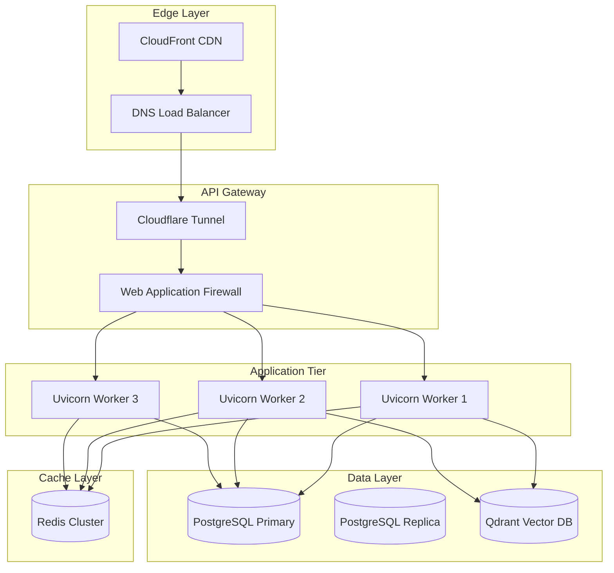
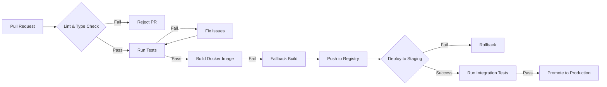

# Learning Management System - Architecture Overview 🎓

> **System Design & Architecture** for LMS Application Product  
**Version:** 1.0 | **Status:** `Initial Draft`

---

## 🏛️ High-Level System Architecture

```mermaid
C4Context
    title Learning Management System - C4 Context Diagram
    
    Person_Ext(student, "Student User", $tag="End User")
    Person_Ext(instructor, "Instructor", $tag="Content Creator")
    Person(admin, "Admin User", $tag="System Administrator")
    
    System(lms_app, "LMS Application", "FastAPI backend with SQLModel database layer", $tags=["Primary"])
    System_Boundary(web, "Web Frontend") {
        Container(ui, "UI Component", "React/Vue/Angular", "Frontend Framework")
    }
    
    System_Boundary(api, "API Layer") {
        Container(gateway, "API Gateway", "Traefik/Kong", "Entry Point, Rate Limiting")
        Container(auth_svc, "Auth Service", "FastAPI + JWT", "$tags=['Microservice']")
        Container(course_svc, "Course Service", "FastAPI + SQLModel", "$tags=['Microservice']")
        Container(user_svc, "User Service", "FastAPI + SQLModel", "$tags=['Microservice']")
        Container(progress_svc, "Progress Service", "FastAPI + Redis", "$tags=['Microservice']")
    }
    
    System_Boundary(data, "Data Layer") {
        ContainerDb(postgres, "PostgreSQL", "Main Database", "$tags=['Database']")
        ContainerCache(redis, "Redis Cluster", "Cache + Message Queue")
        Container(vector, "Qdrant", "Vector embeddings", "$tags=['Search Engine']")
    }
    
    System_Ext(sso, "Identity Provider", "Auth0/Azure AD", "$tags=['External Service']")
    
    Rel(student, web, User interacts with UI)
    Rel(instructor, web, Creates content via UI)
    Rel(admin, web, Manages system configuration)
    Rel(web, gateway, All traffic via API Gateway)
    Rel(gateway, auth_svc, JWT token validation)
    Rel(course_svc, postgres, "$right=Course records")
    Rel(user_svc, postgres, "$right=User profiles + settings")
    Rel(progress_svc, redis, "$right=Cached progress data")
    Rel(auth_svc, sso, "OAuth2/OIDC for SSO")
    Rel(postgres, redis, "Replication events to cache")
    
    UpdateRelStyle(web, gateway, $offset=y, $lineColor=#2196f3, $lineOpacity=0.8)
    UpdateRelStyle(gateway, auth_svc, $offset=-y, $lineColor=#ff9800)
    UpdateRelStyle(course_svc, postgres, $offset=y, $lineColor=#4caf50, $lineWidth=2)
```

---

## 🗄️ Database Schema Design

```mermaid
erDiagram
    USERS ||--o{ COURSE_ENROLLMENTS : "enrolls in"
    USERS ||--o{ PROGRESS_LOGS : "tracks progress"
    USERS ||--o{ ACHIEVEMENTS : "earns"
    
    COURSES ||--o{ COURSE_MATERIALS : "has"
    COURSES ||--o{ QUIZZES : "contains"
    
    COURSE_ENROLLMENTS }|--|| USERS : "belong to"
    COURSE_ENROLLMENTS }|--|| COURSES : "for course"
    
    USERS {
        int id "PK, auto-increment"
        varchar email "unique"
        jsonb preferences
        timestamp created_at
    }
    
    COURSES {
        int id "PK, auto-increment"
        varchar title
        text description
        array tags
        jsonb instructor_id
        status "active|draft|archived"
    }
    
    PROGRESS_LOGS {
        int id "PK"
        int user_id "FK -> users"
        int course_id "FK -> courses"
        int completion_pct
        timestamp last_activity
        varchar activity_type
    }
    
    QUIZZES {
        int id "PK"
        int course_id "FK -> courses"
        array questions
        int due_date
    }
    
    ACHIEVEMENTS {
        int id "PK"
        int user_id "FK -> users"
        varchar achievement_code
        timestamp earned_at
    }
```

---

## 🔀 Design Pattern Implementation Map

| Pattern | Location in Codebase | Responsibility |
|---------|---------------------|---------------|
| **Singleton** | `devmate/src/devmate/api/dependencies.py` | Database session pool |
| **Factory** | `src/devmate/ingest/factory.py` | Chunk type factory function |
| **Strategy** | `src/devmate/llm/providers/` | Different LLM providers (OpenAI, Groq) |
| **Observer** | `src/devmate/obs/events/` | Event-driven notifications |
| **Circuit Breaker** | `src/devmate/agent/circuit_breaker.py` | LLM call failure handling |
| **Repository Pattern** | `src/devmate/db/repositories/` | Abstract data access layer |
| **DTO Pattern** | Pydantic models throughout | Request/response shape control |

---

## 🚀 Deployment Architecture



---

## 📊 Key Metrics & SLOs

| Metric | Target | Monitoring Tool | Alert Threshold |
|--------|--------|------------------|-----------------|
| **Request Latency (p95)** | < 100ms | Prometheus + Grafana | > 200ms |
| **Error Rate** | < 0.1% | OpenTelemetry traces | > 1% for 5 min |
| **Cache Hit Rate** | > 90% | Redis INFO command | < 80% |
| **DB Connection Pool** | Active < 80% | PgBouncer metrics | > 90% saturated |

---

## 🔄 CI/CD Pipeline Design



---

## 📝 Next Steps for LMS Product

1. **Database Layer**: Create SQLModel models in `devmate/src/devmate/db/models.py`
2. **Migrations**: Set up Alembic migration scripts at `.migrations/versions/`
3. **Service Boundary**: Define microservice split points (user, course, progress services)
4. **Event Schema**: Design domain events for progress tracking notifications

---

**Status:** `Design Phase`  
**Last Updated:** 2026-11-10  
**Maintainer:** Mohamed Kandil  
