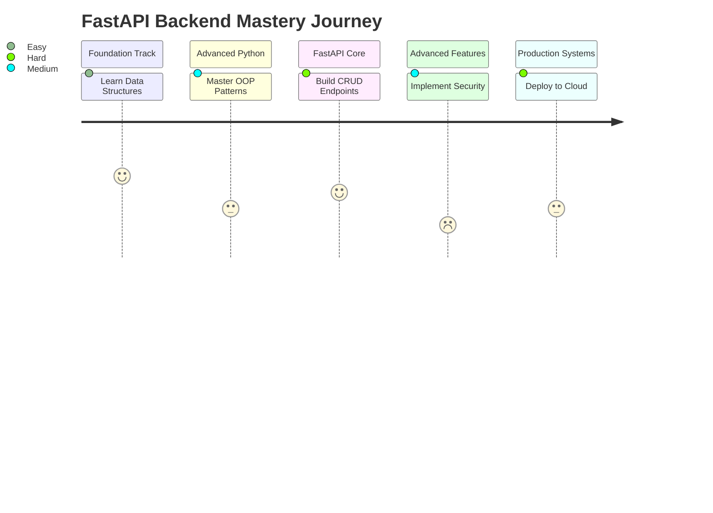
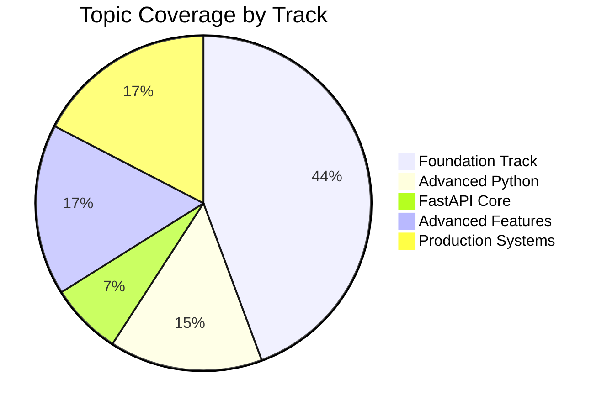
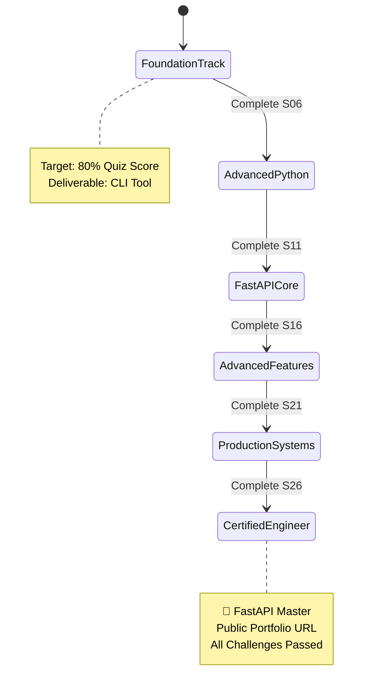

# FastAPI Backend Mastery Roadmap - Visual Diagram

```mermaid
graph TD
    %% Track 1: Foundation
    subgraph Track1["🏗️ Track 1: Foundation (Python Backend Readiness)"]
        S01[("S01: Data Structures")] --> C13["⚡ Challenge: Lists"]
        S01 --> C48["⚡ Challenge: Comprehensions"]
        S02[("S02: Control Flow")] --> C51["⚡ Challenge: Serialization"]
        S03[("S03: Error Handling")] --> C47["⚡ Challenge: Exceptions"]
        S04[("S04: File I/O")] --> C46["⚡ Challenge: CLI Config"]
        S05[("S05: Environment & CLI")]
    end

    %% Track 2: Advanced Python
    subgraph Track2["🔧 Track 2: Advanced Python (API Design Patterns)"]
        S07[("S07: OOP & Design")] --> C43["⚡ Challenge: Dataclasses"]
        S08[("S08: Decorators")] --> C21["⚡ Challenge: Higher-Order Functions"]
        S09[("S09: Async/Await")] --> C22["⚡ Challenge: Async Patterns"]
        S10[("S10: Type Hints")] --> C23["⚡ Challenge: Type Annotations"]
    end

    %% Track 3: FastAPI Core
    subgraph Track3["📦 Track 3: FastAPI Core (Request/Response)"]
        S12[("S12: Request/Response Modeling")] --> C_F1["⚡ Challenge: CRUD with Pydantic"]
        S13[("S13: Dependency Injection")] --> C_F2["⚡ Challenge: DI Patterns"]
        S14[("S14: Route Handling")] --> C_F3["⚡ Challenge: Query Params"]
        S15[("S15: Request Parsing")] --> C_F4["⚡ Challenge: File Uploads"]
    end

    %% Track 4: Advanced Features
    subgraph Track4["🛡️ Track 4: Advanced Features (Scalability)"]
        S17[("S17: Security & Auth")] --> C_A1["⚡ Challenge: OAuth2 Auth"]
        S18[("S18: Middleware")] --> C_A2["⚡ Challenge: Rate Limiting"]
        S19[("S19: Streaming")] --> C_A3["⚡ Challenge: Cloud Storage"]
        S20[("S20: Caching & Perf")] --> C_A4["⚡ Challenge: Background Tasks"]
    end

    %% Track 5: Production
    subgraph Track5["🚀 Track 5: Production Systems (Full Lifecycle)"]
        S22[("S22: Testing Frameworks")] --> C_P1["⚡ Challenge: Pytest Suite"]
        S23[("S23: OpenAPI Docs")] --> C_P2["⚡ Challenge: API Docs Polish"]
        S24[("S24: Database Integration")] --> C_P3["⚡ Challenge: SQLModel Layer"]
        S25[("S25: Deployment Patterns")] --> C_P4["⚡ Challenge: Docker Compose"]
    end

    %% Completion milestone
    M5(✅ Public Portfolio URL) -.-> Track1
    M5 -.-> Track2
    M5 -.-> Track3
    M5 -.-> Track4
    M5 -.-> Track5

    %% Styling
    style Track1 fill:#e8f5e9,stroke:#4caf50,stroke-width:2px
    style Track2 fill:#fff3e0,stroke:#ff9800,stroke-width:2px
    style Track3 fill:#e3f2fd,stroke:#2196f3,stroke-width:2px
    style Track4 fill:#f3e5f5,stroke:#9c27b0,stroke-width:2px
    style Track5 fill:#ffebee,stroke:#f44336,stroke-width:2px
    style C_F1 fill:#ffeb3b,stroke:#ffc107,stroke-width:2px
    style C_F2 fill:#ffeb3b,stroke:#ffc107,stroke-width:2px
    style C_F3 fill:#ffeb3b,stroke:#ffc107,stroke-width:2px
    style C_F4 fill:#ffeb3b,stroke:#ffc107,stroke-width:2px
    style C_A1 fill:#9c27b0,color:white
    style C_A2 fill:#9c27b0,color:white
    style C_A3 fill:#9c27b0,color:white
    style C_A4 fill:#9c27b0,color:white
    style C_P1 fill:#f44336,color:white
    style C_P2 fill:#f44336,color:white
    style C_P3 fill:#f44336,color:white
    style C_P4 fill:#f44336,color:white
```

---

## 📊 Learning Flow Chart

```mermaid
flowchart LR
    subgraph Foundation["Foundation Track"]
        A[Python Basics] --> B[List/Dict Mastery]
        B --> C[File I/O & JSON]
        C --> D[Error Handling]
        D --> E[(10 Core Challenges)]
    end

    subgraph Advanced["Advanced Python Track"]
        E --> F[OOP Patterns]
        F --> G[Decorators & Async]
        G --> H[Type Hints & Generators]
        H --> I[(12 Advanced Challenges)]
    end

    subgraph FastAPICore["FastAPI Core Track"]
        I --> J[Pydantic Models]
        J --> K[Dependency Injection]
        K --> L[CRUD Endpoints]
        L --> M[(5 Core API Challenges)]
    end

    subgraph AdvancedFeatures["Advanced Features Track"]
        M --> N[Security & Auth]
        N --> O[Middleware Patterns]
        O --> P[Streaming Responses]
        P --> Q[(4 Enterprise Challenges)]
    end

    subgraph Production["Production Track"]
        Q --> R[Testing Frameworks]
        R --> S[OpenAPI Documentation]
        S --> T[Docker Deployment]
        T --> U[(5 Production Challenges)]
        U --> V(🎯 Public Portfolio URL)
    end

    style Foundation fill:#e8f5e9,stroke:#2e7d32,stroke-width:3px
    style Advanced fill:#fff3e0,stroke:#ef6c00,stroke-width:3px
    style FastAPICore fill:#e3f2fd,stroke:#1565c0,stroke-width:3px
    style AdvancedFeatures fill:#f3e5f5,stroke:#7b1fa2,stroke-width:3px
    style Production fill:#ffebee,stroke:#c62828,stroke-width:3px
    style V fill:#1b5e20,color:white,stroke:#4caf50,stroke-width:4px
```

---

## 🎯 Topic Progression Map

---

## 📈 Statistics Dashboard

---

## 🎓 Certification Path

---

## 📝 Legend

| Symbol | Meaning | Example |
|--------|---------|---------|
| `S01-S26` | Learning Section | Data Structures, OOP |
| `C_F1-C_F4` | FastAPI Core Challenge | CRUD with Pydantic |
| `C_A1-C_A4` | Advanced Challenge | OAuth2 Authentication |
| `C_P1-C_P4` | Production Challenge | Pytest Integration |
| 🏗️ | Foundation Track | Python basics |
| 🔧 | Advanced Track | API patterns |
| 📦 | FastAPI Core | Request/Response |
| 🛡️ | Security Track | Authentication |
| 🚀 | Production Track | Deployment |

---

## 🎯 Key Metrics

- **Total Topics:** 26 sections
- **Total Challenges:** 30+ challenges
- **Target Completion Time:** 14-18 weeks (at 3 topics/week)
- **Final Deliverable:** Public FastAPI Portfolio URL

---

**Roadmap Version:** 1.0  
**Last Updated:** 2026-11-10  
**Maintained By:** Mohamed Kandil
