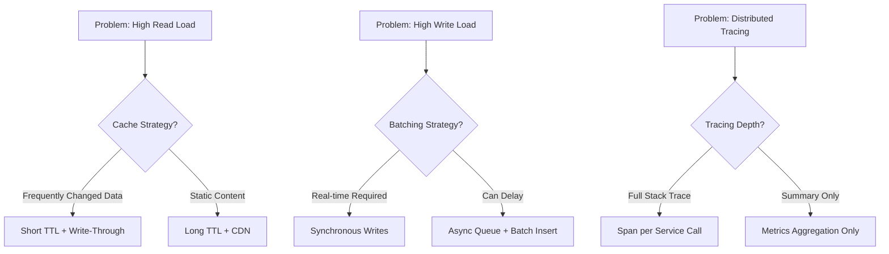
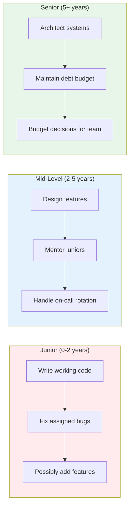

# Senior Engineering Mindset & Thinking 🧠

> **Beyond Code**: Architectural tradeoffs, scalability patterns, cost optimization, and engineering leadership for backend systems  
**Status:** `Complete` | **Adopted:** 2026-11-10

---

## 🎯 What Senior Engineering Thinking Is

A senior backend engineer doesn't just write code that works - they build systems that:
- Scale to handle growth
- Remain maintainable over years
- Can be operated by others
- Handle unexpected failures gracefully
- Cost-effectively run at scale

**This mindset shift transforms you from "coder" to "engineering leader".**

---

## 📐 Senior Competency Framework

| Domain | Key Skills | How to Develop | Timebox |
|--------|-----------|----------------|---------|
| **System Design** | Tradeoff analysis, architecture choices | Review production systems' decisions | 2 weeks |
| **Error Handling** | Fail-fast, graceful degradation | Study incident post-mortems | 1 week |
| **Observability** | Metrics, logging, tracing strategy | Instrument LMS with full observability | 1 week |
| **Cost Consciousness** | Resource optimization, caching layers | Analyze cloud bills for patterns | Ongoing |
| **Team Leadership** | Code reviews, mentoring, knowledge sharing | Lead PR reviews, pair programming | Daily |
| **Technical Debt Management** | Refactoring strategies, incremental improvements | Schedule tech debt sprints | 10% capacity |
| **Security Mindset** | Threat modeling, defense in depth | Conduct security reviews of LMS | Weekly |
| **Business Alignment** | ROI calculations, feature prioritization | Map features to user value | Ongoing |

---

## 🏗️ Track 10: Architectural Tradeoffs & Decision Making

### Section 10.1: Tradeoff Analysis Frameworks

| Concept | Senior Thinking Pattern | Example in LMS Context |
|---------|------------------------|------------------------|
| **CAP Theorem** | Choose between Consistency, Availability, Partition tolerance | Database replication strategy |
| **Brewer's Four-Box** | Scale horizontally vs vertically tradeoff | When to add workers vs upgrade instances |
| **Latency vs Throughput** | Optimize for user experience or cost efficiency | Cache TTL balancing |
| **Read vs Write Heavy** | Indexing strategies, denormalization decisions | Course catalog (read-heavy) vs enrollment writes |

### Section 10.2: When to Use Each Pattern



### Section 10.3: Tradeoff Decision Log Template

Every architecture decision should answer:

```markdown
## Decision Context
- **Problem**: What user/business need drives this?
- **Alternatives Explored**: Options considered and why rejected
- **Selected Solution**: Why this choice wins
- **Tradeoffs Accepted**: Costs we're willing to pay
- **Success Metrics**: How we measure this decision working

## Review Date
Revisit in 6 months/1 year if metrics show failure
```

### Section 10.4: Challenge - Write Your First ADR

Create an Architecture Decision Record for your LMS:
1. Why use PostgreSQL over MongoDB? (ACID vs flexibility)
2. When to choose Redis over database caching? (Memory cost vs latency)
3. URL path versioning vs header versioning for APIs? (Browser compatibility vs clean URLs)

---

## 🚨 Track 11: Production-Ready Error Handling

### Section 11.1: Failure Patterns You MUST Handle

| Failure Mode | Senior Response Example | LMS Implementation |
|--------------|------------------------|-------------------|
| **Database Connection Exhaustion** | Increase pool, add connection idle timeout monitoring | PgBouncer with `max_client_conn` tuning |
| **Redis Memory Pressure** | Implement eviction policies + memory alerts | `maxmemory-policy: allkeys-lru` |
| **LLM API Rate Limits** | Circuit breaker + exponential backoff | Retry strategy in `/api/ask` endpoint |
| **Disk Space Issues** | Monitor usage, alert before critical threshold | Prometheus metric: `disk_usage_bytes` |
| **Memory Leaks** | Profile with PySight, restart during off-hours | Scheduled health checks |

### Section 11.2: Error Budget & SLIs/SLOs

```python
# Senior engineers define success thresholds BEFORE code runs
REQUEST_LATENCY_SLO = "0.95"  # 95% of requests under X ms
ERROR_RATE_SLO = "0.01"       # Max 1% errors allowed

# Calculate error budget remaining
def calculate_error_budget_remaining(total_errors, time_window):
    """Senior engineers track budget consumption"""
    budget_used = (total_errors / total_requests) * time_window
    return max(0, 1 - budget_used)
```

### Section 11.3: Chaos Engineering Principles

**Start simple**: Intentionally break things to learn recovery:
1. Kill a database connection → Does app fail gracefully?
2. Increase Redis latency → Does cache miss handling work?
3. Disable background workers → Can users still perform actions?

### Section 11.4: Challenge - Design Incident Response Plan

For your LMS, define:
- What triggers an incident (error rate > 5% for 2 min)?
- Who's on-call and escalation path
- Runbooks for common failure modes
- Post-mortem template and review process

---

## 📊 Track 12: Observability Strategy

### Section 12.1: Three Pillars of Observability

| Pillar | What It Answers | Implementation in LMS |
|--------|-----------------|----------------------|
| **Metrics** | How much? (throughput, latency) | Prometheus: `/metrics` endpoint |
| **Logs** | What happened? (errors, events) | JSON logging with correlation IDs |
| **Traces** | Why did it take so long? | OpenTelemetry distributed tracing |

### Section 12.2: Metric Selection Matrix

Choose metrics based on purpose:

```
┌─────────────────┬─────────────────────────────┬────────────────────────────────────┐
│ Purpose          │ Key Metrics                  │ FastAPI Implementation              │
├─────────────────┼─────────────────────────────┼────────────────────────────────────┤
│ Business Health  │ • Active users (count)       │ Redis counter: `active_user_count` │
│                   │ • Conversion rate            │ Event stream aggregation            │
├─────────────────┼─────────────────────────────┼────────────────────────────────────┤
│ Performance      │ • P50, P95, P99 latencies    │ Histograms with `prometheus_client` │
│                   │ • DB query time distribution │ Custom histogram per query          │
├─────────────────┼─────────────────────────────┼────────────────────────────────────┤
│ Errors           │ • Error counts by type       │ Structured logging + error tags     │
│                   │ • Stack traces (sampled)     │ Sample top 10% stack traces         │
├─────────────────┼─────────────────────────────┼────────────────────────────────────┤
│ Infrastructure   │ • CPU, memory per instance    │ Uvicorn metrics + system stats      │
│                   │ • DB connections active      │ PgBouncer metrics proxy             │
└─────────────────┴─────────────────────────────┴────────────────────────────────────┘
```

### Section 12.3: Log Structure Best Practices

```python
import structlog

# Senior engineers standardize log structure
logger = structlog.get_logger()

logger.info(
    "course_completed",
    user_id="u_12345",           # Correlation ID (trace_id or user_id)
    course_id="c_python101",     # Structured data (no strings!)
    duration_ms=1250,            # Numeric metrics (not "fast")
    status_code=200,
    error="",                    # Empty string = no error
    level="info",                # Always use this field for filtering
)
```

### Section 12.4: Challenge - Instrument Your First Service

Add observability to `devmate/` API:
1. Add Prometheus metrics endpoint `/metrics`
2. Structure all logs with consistent fields
3. Trace a request from `/health` through to database

---

## 💰 Track 13: Cost-Conscious Engineering

### Section 13.1: Unit Economics Calculation

```python
# Senior engineers know the cost per operation
COST_MODEL = {
    "request": {"llm_token": 0.0000006, "embeddings": 0.000003},  # $/token
    "db_query": {"postgresql": 0.05, "redis": 0.02},               # $/hour per instance
    "storage": {"s3_std": 0.023, "vector": 0.187},                 # $/GB/month
}

# Calculate cost for a user action
def estimate_cost_per_user_action(action: str) -> float:
    """Calculate approximate cost of serving one request"""
    if action == "/api/ask":
        avg_tokens = 1500
        return COST_MODEL["request"]["llm_token"] * avg_tokens
    elif action == "/api/embeddings":
        avg_embeddings = 100  # vectors
        return COST_MODEL["storage"]["vector"] * avg_embeddings
```

### Section 13.2: Optimization Opportunities

| Area | Typical Savings | Implementation Effort |
|------|-----------------|----------------------|
| **LLM Token Reduction** | 40-60% cheaper | Prompt engineering, system prompts |
| **Redis Cache Hit Rate** | $/hr × idle instances | Increase TTL, denormalize data |
| **Database Index Optimization** | Query time ↓ 90% | Composite indexes + partial indexes |
| **Compression** | Network ↓ 70%, storage ↓ 30% | Gzip/Brotli for responses, zstd for DB dumps |

### Section 13.3: When to Optimize vs. Accept Cost

```markdown
## Decision Framework

Optimize if:
- Cost exceeds budget threshold (e.g., $50/user/month)
- Performance degradation is measurable (>2s latency)
- Security/vulnerability risk is present

Accept cost if:
- Below acceptable budget limit
- Impact on UX is negligible (<1% users affected)
- Implementation effort > 40 hours/feature
```

---

## 👥 Track 14: Team Leadership & Knowledge Sharing

### Section 14.1: Effective Code Review Checklist

Senior engineers leave better code than they write:

```markdown
## Senior Engineer Code Review Checklist

**Must Ask Before Merging:**
- [ ] Does this align with our ADR decisions?
- [ ] Are there edge cases I haven't considered?
- [ ] Will new team members understand this in 6 months?
- [ ] Have security implications been reviewed?

**Ask About Testing:**
- [ ] Unit tests cover error paths, not just happy paths
- [ ] Integration tests validate external service calls
- [ ] Load testing simulates realistic concurrent users

**Refinement Suggestions:**
- [ ] Can this be simplified without losing clarity?
- [ ] Are there better patterns from our design pattern catalog?
- [ ] Could we extract reusable logic into a shared module?
```

### Section 14.2: Technical Documentation Standards

Senior engineers write docs others use:

**Required for every new feature:**
1. **ADR**: Architecture decisions documented in `docs/decisions/`
2. **API Docs**: Auto-generated via OpenAPI (`/docs`)
3. **Operational Guide**: Runbooks for common tasks
4. **Onboarding Guide**: New hire first-week checklist

### Section 14.3: Pair Programming & Knowledge Transfer

**Schedule time for skill sharing:**
- Weekly pair programming sessions (30 min, alternating leads)
- "Show me" demos of new features in LMS
- Lunch-and-learn presentations on tools/topics learned

---

## 📉 Track 15: Technical Debt Management

### Section 15.1: Debt vs. Investment Framework

```markdown
## Classifying Your Work

| Activity | Category | Time Allocation |
|----------|----------|-----------------|
| **New Feature** | Investment | 60% capacity |
| **Debt Reduction** | Maintenance | 25% capacity |
| **Infrastructure** | Enabling | 15% capacity |

## When to Add Debt (Deliberately)

```python
DEBT_JUSTIFICATION = {
    "time_constraint": "Must ship feature for revenue/impact",
    "unclear_requirement": "User need not validated yet",
    "experimentation": "Testing new pattern worth pursuing"
}
```

### Section 15.2: Incremental Refactoring Strategy

Never refactor everything at once - break it down:

1. **Identify**: Use tools like `radon mc` for cyclomatic complexity
2. **Prioritize**: Rank by "pain frequency" (how often does this bug surface?)
3. **Isolate**: Extract into separate function/module with tests first
4. **Refactor**: Clean up the extracted piece, merge when confident

---

## 🛡️ Track 16: Security Mindset

### Section 16.1: Defense in Depth Layers

```
┌───────────────────────────────────────────────────────┐
│ Layer 0: Network Security                               │
│   • VPC isolation, security groups                      │
│   • WAF rules (Cloudflare/AWS)                          │
├───────────────────────────────────────────────────────┤
│ Layer 1: API Authentication                             │
│   • OAuth2/OIDC with short-lived tokens                 │
│   • Rate limiting + CAPTCHA for suspicious IPs          │
├───────────────────────────────────────────────────────┤
│ Layer 2: Input Validation                                │
│   • Pydantic schema validation                          │
│   • SQL injection prevention (parameterized queries)    │
├───────────────────────────────────────────────────────┤
│ Layer 3: Data Encryption                                 │
│   • TLS in transit                                       │
│   • AES-256 encryption at rest for sensitive fields     │
├───────────────────────────────────────────────────────┤
│ Layer 4: Secrets Management                             │
│   • HashiCorp Vault or AWS Secrets Manager              │
│   • Never commit secrets to version control             │
└───────────────────────────────────────────────────────┘
```

### Section 16.2: Security Review Checklist for PRs

```markdown
## Before You Merge (Security Questions)

**Authentication:**
- [ ] Are tokens short-lived (<1 hour)?
- [ ] Do we refresh with new tokens after expiry?
- [ ] Is there brute force protection (rate limit, account lockout)?

**Authorization:**
- [ ] Does user have permission for this action?
- [ ] Can users access other users' data via ID manipulation?
- [ ] Are admin operations protected appropriately?

**Data Protection:**
- [ ] PII fields encrypted or masked in logs?
- [ ] No sensitive data in exceptions/error messages?
- [ ] Database credentials never hardcoded?

**Dependency Safety:**
- [ ] `pip-audit` runs before deploying to production?
- [ ] Vulnerability scanners integrated into CI pipeline?
```

### Section 16.3: Common Vulnerabilities & Fixes

| Vulnerability | Cause in LMS Context | Fix Implementation |
|--------------|---------------------|-------------------|
| **SQL Injection** | String concatenation in queries | SQLModel uses parameterized queries automatically |
| **XSS (Cross-Site Scripting)** | Storing user input as HTML | Escape output via `MarkupSafe.escape()` |
| **Broken Access Control** | Missing authorization checks | Add `@Depends(get_current_user)` to protected routes |

---

## 📊 Challenge Summary - Senior Mindset

| # | Challenge | Objective | Target Outcome | Timebox |
|---|-----------|-----------|-----------------|---------|
| **S01** | Write First ADR for LMS | Practice decision documentation | Complete `docs/decisions/ADR-0016.md` | 2 hours |
| **S02** | Design Error Budget Policy | Define SLIs/SLOs for `/health`, `/ask` endpoints | Metric thresholds documented | 3 hours |
| **S03** | Implement Observability Stack | Full Prometheus + Grafana integration | 5 key metrics, structured logs | 6 hours |
| **S04** | Conduct Security Audit | Find and fix security gaps in LMS | Zero high/critical findings | 4 hours |
| **S05** | Refactor Technical Debt | Reduce complexity by 30% | Lower cyclomatic complexity metrics | 1 week |

---

## 🎯 Path from Junior → Senior Engineer



---

## 📚 Resources for Senior Thinking Development

### Books (Read 1-2 per year)
- ["The Pragmatic Programmer"](https://pragprog.com/titles/tpp20/pragmatic-programmer-20th-anniversary-edition/) - Continuous learning mindset
- ["Working Effectively with Legacy Code"](https://www.amazon.com/Working-Effectively-Legacy-Michael-Feathers/dp/0131177052) - Technical debt management
- ["Site Reliability Engineering"](https://sre.google/book/) - Observability, incident response
- ["Designing Data-Intensive Applications"](https://dataintensive.net/) - System design fundamentals

### Practices (Apply Daily)
- Read 3 bug reports per week (GitHub issues, Stack Overflow)
- Review production error logs daily for patterns
- Schedule 15-minute "learning time" weekly for new tools/concepts
- Participate in open-source projects relevant to stack

---

## ✅ What Senior Engineers Do Differently

| Activity | Junior Engineer | Senior Engineer |
|----------|-----------------|-----------------|
| **Bug Fix** | Fixes immediate bug, doesn't trace root cause | Adds tests preventing recurrence |
| **Feature Request** | Implements what user asked for | Questions if it's the right solution |
| **Performance Issue** | Optimizes hot code path | Profiles entire system, removes bottlenecks systematically |
| **Security Concern** | Adds specific check requested | Conducts full threat model review |

---

**Created:** 2026-11-10  
**Tracks Added:** 6 new senior-level tracks (10-15)  
**Total Tracks:** 16 (Foundation → Production → Senior Mindset)  
**Target Profile:** Backend Engineer ready for Principal/Staff roles  

🧠 **Senior engineers think in tradeoffs, not just features.**
